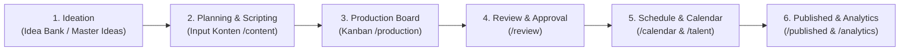

# EXISTING WORKFLOW DOCUMENTATION
## PRIMA RIB CONTENT PLAN — AI-POWERED PLATFORM EXTENSION
**Document:** End-to-End Operational & Production Workflows Audit  
**Phase:** Phase 0 — Existing System Audit  
**Date:** 2026-11-06  
**Source Components:** `app/content/`, `app/production/`, `app/calendar/`, `app/talent/`, `app/review/`, `app/published/`, `lib/store.ts`  

---

## 1. Overview Alur Kerja Konten Prima RIB

Platform Prima RIB Content Plan dibangun untuk mendukung ritme posting media sosial terstruktur dengan pola mingguan:
- **Senin, Rabu, Jumat:** Konten Feed (Carousel / Single Post)
- **Selasa & Kamis:** Konten Reel / Video Vertikal (Talent Model, Mentor / Pengajar, Siswa)
- **Rotasi Bulanan 4 Minggu:**
  - Minggu 1: Fokus CPNS (SKD, TIU, TWK, TKP)
  - Minggu 2: Fokus Sekolah Kedinasan (STAN, IPDN, STIS, Poltekim)
  - Minggu 3: Fokus Polri (Akpol, Bintara, Psikotes, Kesamaptaan)
  - Minggu 4: Fokus General & Konversi (Strategi Belajar, Promo Kelas Baru)

---

## 2. Alur Kerja Rinci per Tahapan

---

### 2.1 Alur 1: Ideation (Idea Bank & Master Bank)
- **Halaman:** `/ideas` & modal master di `/content`
- **Aktor:** Content Planner, Copywriter
- **Proses:**
  1. User dapat memasukkan ide baru secara manual (Judul, Deskripsi, Wilayah/Program, Pilar, Prioritas).
  2. Tersedia daftar pustaka ide master (*Raw Master Ideas*) dari PDF Masterplan yang siap dikonversi ke konten terencana dengan 1 klik ("Jadikan Konten").
  3. Status Ide bergerak dari: `NEW` ➔ `SELECTED` ➔ `PLANNED` (atau `ARCHIVED`).

---

### 2.2 Alur 2: Planning & Scripting (Input Konten)
- **Halaman:** `/content`
- **Aktor:** Content Planner, Copywriter
- **Proses:**
  1. Input data metadata: Judul konten, Wilayah Program (CPNS/Sekdin/Polri), Pilar Konten, dan Format Postingan.
  2. Jika format adalah **Reel**, wajib memilih **Kategori Talent**:
     - *Talent Model* (Ungu `#7E60FF`)
     - *Mentor / Pengajar* (Biru `#2B7FFF`)
     - *Siswa* (Oranye `#F97316`)
  3. Jika format adalah **Carousel**, sistem menyediakan input per-slide (Slide 1 Hook, Slide Isi, Slide Akhir CTA).
  4. Penyusunan naskah: Hook pembuka, main copy/body, call-to-action (CTA), caption Instagram, dan hashtags.
  5. Penyimpanan memicu `createContentAction` / `updateContentAction` yang menghasilkan kode `PR-YYYY-XXXX`.

---

### 2.3 Alur 3: Production Board & Kanban
- **Halaman:** `/production`
- **Aktor:** Content Planner, Designer, Video Editor
- **Proses:**
  1. Kartu konten ditampilkan dalam kolom Kanban berdasarkan status:
     - `PLANNED` (Direncanakan)
     - `BRIEF` (Penyusunan Brief Desain/Video)
     - `PRODUCTION` (Proses Desain & Editing)
     - `REVIEW` (Menunggu Reviewer)
     - `REVISION` (Revisi Catatan)
     - `APPROVED` (Disetujui, Siap Dijadwalkan)
  2. Perubahan status divalidasi oleh fungsi `VALID_STATUS_TRANSITIONS` di `lib/constants.ts` (tidak dapat melompati tahapan wajib).
  3. Penugasan PIC: Tim dapat menetapkan desainer atau video editor yang bertanggung jawab.

---

### 2.4 Alur 4: Review, Approval & Revisi
- **Halaman:** `/review`
- **Aktor:** Reviewer, Admin
- **Proses:**
  1. Reviewer memeriksa kesesuaian script, visual brief, dan copywriting.
  2. Jika sudah sesuai, reviewer memilih **"Approve"** ➔ Status berubah menjadi `APPROVED`.
  3. Jika memerlukan perbaikan, reviewer memilih **"Minta Revisi"** beserta catatan revisi ➔ Status kembali ke `REVISION`.
  4. Seluruh keputusan dicatat dalam tabel `content_reviews` dan audit log `content_activity`.

---

### 2.5 Alur 5: Penjadwalan & Distribusi (Calendar & Talent View)
- **Halaman:** `/calendar` dan `/talent`
- **Aktor:** Planner (di `/calendar`), Talent Model / Pengajar / Siswa (di `/talent`)
- **Fitur Kalender (`/calendar`):**
  - Matriks 4 minggu (Senin–Jumat) berlabel aturan harian (Senin=Feed, Selasa=Reel, dst).
  - Konten yang berstatus `APPROVED` dapat di-drag atau dijadwalkan ke tanggal tertentu (`scheduled_at`).
  - Fitur **Cetak PDF Resmi 1-Halaman A4 Landscape** yang telah disesuaikan agar tidak terpotong (fit-to-page).
  - Fitur **Lembar Script Talent 2-Kolom** untuk kebutuhan shooting di studio Prima RIB.
- **Fitur Talent View (`/talent`):**
  - Tampilan mobile-first yang responsif, bersih, dan bebas menu teknis.
  - View-only: Talent dapat membaca tanggal shooting, kategori talent, dan naskah lengkap (script whitespace-pre-line yang nyaman dibaca di smartphone).
  - Sinkronisasi otomatis setiap 6 detik via `/api/cloud-state`.

---

### 2.6 Alur 6: Publikasi & Pelaporan Performa
- **Halaman:** `/published`, `/reports`, `/analytics`
- **Aktor:** Content Manager, Admin
- **Proses:**
  1. Konten yang telah tayang di Instagram, Facebook, atau TikTok ditandai sebagai `PUBLISHED` dengan URL postingan aktif.
  2. Input data analitik: Views, Reach, Likes, Comments, Shares, Saves, dan perhitungan otomatis Engagement Rate (formula: `(Likes + Comments + Shares + Saves) / Reach * 100`).
  3. Rekapitulasi bulanan pada `/reports` untuk evaluasi pilar mana yang paling efektif.

---

## 3. Titik Integrasi Alur AI Baru (PRD Integration Points)

AI yang akan diintegrasikan pada fase-fase berikutnya akan menyuntikkan kapabilitas pada titik-titik alur ini:

1. **Titik 1 (Ideation):** AI Content Strategist (`/ideas`) menghasilkan ide konten berbasis brand knowledge dan analisis gap.
2. **Titik 2 (Scripting):** AI Script Builder (`/content`) menyediakan tombol "Generate Script dengan AI", "Rewrite Section", dan "Sesuaikan Tone of Voice".
3. **Titik 3 (Briefing):** Creative Brief Generator membuat instruksi desain/video otomatis untuk Designer & Editor.
4. **Titik 4 (Review):** AI Quality Checker (`/review`) memberikan pre-review skor kepatuhan brand voice, keterbacaan, dan peringatan fakta sebelum persetujuan manusia.
